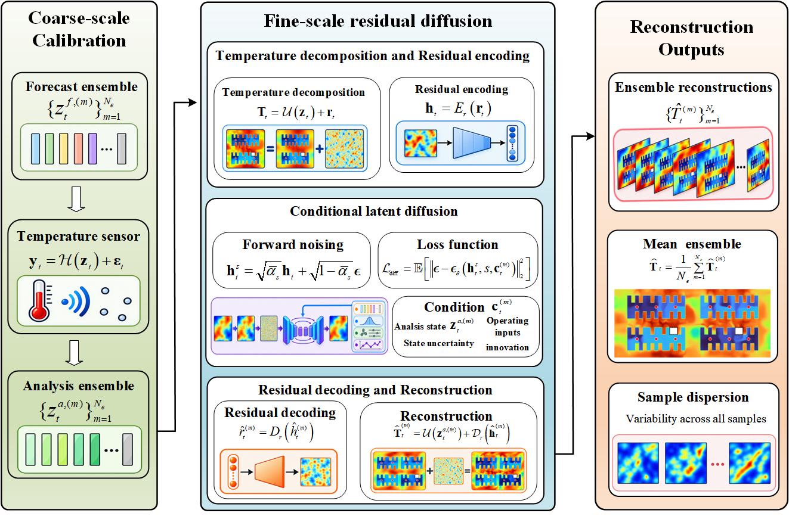

# Physics-Calibrated Residual Diffusion for Transient Thermal Field Reconstruction in Data Centers

This repository contains the code for **Physics-Calibrated Residual Diffusion for Transient Thermal Field Reconstruction in Data Centers**.

## Overview

This study proposes a physics-calibrated residual diffusion model for transient temperature field reconstruction in data centers. A physics-based zonal thermal model captures transient thermal dynamics and is calibrated using sparse temperature measurements. Conditioned on the calibrated zonal states, a residual diffusion model reconstructs fine-scale temperature structures, particularly improving hot-spot reconstruction accuracy.

The reconstructed temperature field combines the calibrated zonal temperature baseline with the generated fine-scale residual.

## Method

- **Zonal thermal dynamics:** A physics-based zonal model captures inter-zone heat transport, rack heat dissipation, and cooling effects, with a neural network term for unresolved dynamics.
- **Temperature measurement assimilation:** An ensemble Kalman filter (EnKF) calibrates zonal states using sparse temperature measurements.
- **Residual diffusion:** A conditional latent diffusion model reconstructs fine-scale temperature residuals to recover high-resolution temperature fields.

$$
\widehat{\mathbf{T}}_t^{(m)} = U\!\left(\mathbf{z}_t^{a,(m)}\right) + D_\phi\!\left(\widehat{\mathbf{h}}_t^{(m)}\right).
$$

Here, $U$ expands zonal states to the CFD grid and $D_\phi$ decodes the fine-scale residual.


*Figure 6 from the manuscript. Coarse-fine scale hierarchical calibration framework.*

## Experiments

The method is evaluated using two data center cases:

- **Istanbul, Turkey:** A publicly available benchmark from the Radius Solution Center. Nine experimental temperature measurements are used to assess the steady-state CFD model, yielding an RMSE of **0.921 °C**. Under extrapolation conditions, the proposed method achieves full-field and top 5% hot-spot RMSEs of **0.651 °C** and **1.205 °C**.
- **Yiwu County, Hami, China:** A real-world data center with 70 racks and 46 cooling units. The proposed method achieves full-field and top 5% hot-spot RMSEs of **0.358 °C** and **0.367 °C**.

Comparisons include **Zone-Analysis-Const**, **4D-SRDA**, and **DiffSRDA**.

## Code

The repository includes code for zonal thermal modeling, data assimilation, residual diffusion, temperature field reconstruction, and evaluation.

```bash
git clone https://github.com/like-a-robot/Physics-Calibrated-Residual-Diffusion.git
cd Physics-Calibrated-Residual-Diffusion
```
Use the repository's existing scripts and configuration files for training, reconstruction, and evaluation.

## Installation

Use **Python 3.10+** and install the dependencies in your Python environment:

```bash
python -m pip install -r requirements.txt
```

```bash
python scripts/run_all.py --device cuda:0
```

The implementation uses PyTorch, NumPy, SciPy, Matplotlib, and PyYAML. For GPU execution, use a PyTorch build compatible with your CUDA environment and select `--device cuda:0`. CPU execution is available through `--device cpu`.

## Data

The transient CFD datasets used in this study are not included in the repository and may be requested from the corresponding author.

## Citation

If you use this code, please cite the manuscript:

**Yueyue Guo, Lei Su, Le Zhang, and Yang Liu.** *Physics-Calibrated Residual Diffusion for Transient Thermal Field Reconstruction in Data Centers*. 2026.

## Contact

Lei Su — sul@xju.edu.cn
